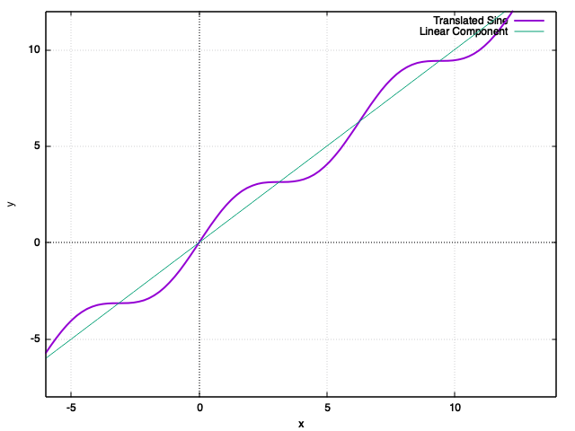

# GnuPlot Exercises

## Exercise 1

### (a) $f(x) = sin(x) + x$

```
gnuplot> f(x) = x + sin(x)
gnuplot> g(x) = sin(x)
gnuplot> h(x) = x
gnuplot> plot f(x) lw 2, h(x) lw 1
gnuplot> set zeroaxis
gnuplot> set xlabel 'x'
gnuplot> set ylabel 'y'
gnuplot> set grid
gnuplot> replot
gnuplot> plot f(x) lw 2 title 'Translated Sine', h(x) lw 1 title 'Linear Component'
```



### (b) $f(x) = x^2 + x + 1$

