\vspace{2.5em}

\noindent\fbox{%
  \parbox{\dimexpr\linewidth-2\fboxsep-2\fboxrule}{%
    \textbf{Author:} Koushani Roy \\
    \textbf{Roll No:} 134 \\
    \textbf{Semester:} 1 \\
    \textbf{Paper Code:} C1PH230112P \\
    \textbf{Subject:} Clab - 1, UG (Physics) \\
    \textbf{Institution:} St. Xavier's College (Autonomous), Kolkata \\
    \textbf{Date:} October 25, 2026
  }%
}

## 1. Commands shown in Class - `plotlab1`

### 1.1 Intialisation

#### Windows

Type `wgnuplot` in desired directory in the terminal window.

#### Mac OS/Linux

Does not have any dedicated GUI like `wgnuplot.exe` for Windows. Type `gnuplot` in termnal to begin.

---

Initialising in a Windows machine:

```bash

 G N U P L O T
        Version 6.0 patchlevel 4    last modified 2025-12-18 

        Copyright (C) 1986-1993, 1998, 2004, 2007-2025
        Thomas Williams, Colin Kelley and many others

        gnuplot home:     http://www.gnuplot.info
        faq, bugs, etc:   type "help FAQ"
        immediate help:   type "help"  (plot window: hit 'h')

        Terminal type is now windows
 gnuplot> 
```

Note: If mathematical symbols not rendered correctly, you must run `set term win enhanced` to be sure.

### 1.2 Plotting basic curves

```bash
        gnuplot> plot sin(1/x)
```


### 1.3 Setting range and axis

```bash
        gnuplot> set zeroaxis
        gnuplot> plot [-pi:pi] sin(1/x**2)
```


### 1.4 Adding colours and changing line widths

```bash
        gnuplot> plot [-pi:pi] [:] sin(x) ls 2 lw 3  
        gnuplot> plot [-pi:pi] [:] sin(x) ls 2 lw 3, cos(x) ls 7 lw 3
        gnuplot> plot [-pi:pi] [:] sin(x) ls 2 lw 3, cos(x) ls 7 lw 3 lc 'blue'
```

The part `[:]`  lets the y-axis autoscale. You can stack subsequent functions in one graph by separating the instructions with a `,`. 

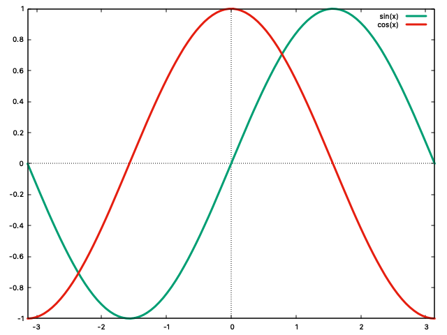

`ls` stands for linestyle (one of the presets gnuplot comes with, different presets have different colour or dash pattern combos). However you can explicitely force features on the linestyles too for example, `lc 'blue'` forces linecolour blue on whatever colour linestyle 7 would have defaulted to. 

`lw` stands for linewidth and determines how bold the lines are. 

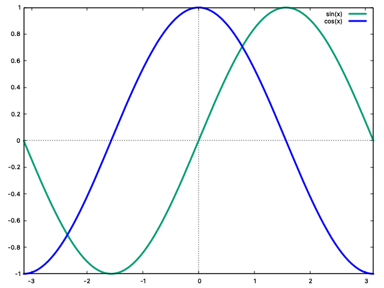

### 1.5 Other features

- There are different terminal types in gnuplot: some open an interactive window, some write straight to a file.

- Zoom in on functions by clicking and dragging a rectangle on the plot.

- Moving the cursor at different points on curve reveals the coordinates.

- Press 'r' to introduce a ruler element which is intersection of two lines and tells you the distance of different other points you hover from that given point.

- In mathematical operations use `**` for exponents. 

```bash
        gnuplot> h(x) = x**2 - 2**x + 1 
        gnuplot> plot h(x)
```

### 1.6 Entering points to a data block and plotting

The data block is named `$name_of_block` and a end-of-line character is specified with a `<<` and data entry is taken per line, columns of two.

```bash
gnuplot> h(x) = sin(x)
gnuplot> $data << EOD 
1.56 0.9998 
2.34 0.567
EOD
```


### 1.7 Loading code from a file

Provided you are in same directory as the file (quick check with `pwd`), it can be loaded with the `load` command. File extension is generally `txt` and it is customary to use `_plt`. In the prospective text file it is advised to use a `reset` command at beginning to restore default settings.

```bash
gnuplot> load 'mysine_plt.txt' 
gnuplot> load 'mysine_plt.txt'
```

### 1.8 Setting titles and labels

The x and y axes names are customisable using `xlabel` and `ylabel` respectively. The function names can also be specified using `title`.

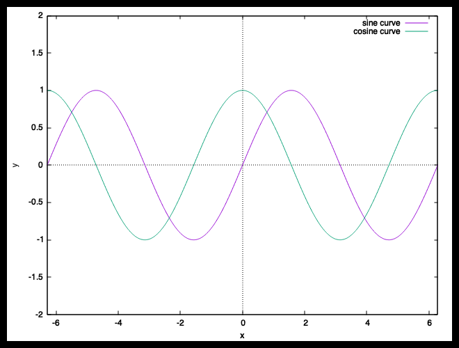

```bash
gnuplot> set xlabel 'x'
gnuplot> set ylabel 'y'
gnuplot> f(x) = sin(1/x)
gnuplot> g(x) = cos(1/x)
gnuplot> plot [-2*pi:2*pi] f(x) lw 2 title 'sine curve', g(x) lw 2 title 'cosine curve'
```

### 1.9 Adjusting Sampling in a Range

Increasing sample sizes makes curve more detailed, smoother. 

```bash
gnuplot> show sample

        sampling rate is 100, 100 #default sampling size

gnuplot> plot sin(1/x)
gnuplot> set samples 1000
gnuplot> plot sin(1/x) #smoother curve

```
The default sampling size is 100.


We set the sampling size to 1000 for a more detailed portion in the around zero range. Using `replot` instead of typing same cmd also works.


## 2. Commands shown in Class - `plotlab2`

### 2.1 Data Files

So far, data points have been stored in a specific `$data_block` with a `EOF` character marking end of data input. 

Data points can also be stored in a certain file and extracted at will. A data file is a plain text file (Notepad, or any text editor) with numbers arranged in columns. Each row is one measurement. Columns are separated by whitespace (a tab, or at least two spaces).

Example contents of `data.txt`:

```
 x    y1    y2
1.2    2.3   2.5
2.4    4.5   4.3
3.2    5.6   5.7
4.5    7.6   9.5
```

Plot the points with the with `plot 'data.txt'`.

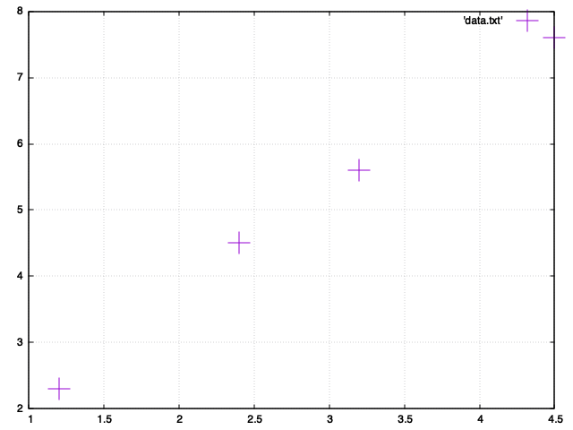

Interpretation:

- Column 1 is taken as x, column 2 as y. If there are more columns, they are extra y-values for the same x.

- A line starting with `#` is a comment.

- If the file has only one column, gnuplot treats it as y and uses the row number as x (counting from 0, so 0, 1, 2, ...).

### 2.2 Plotting a file and choosing columns with `using`

```bash
gnuplot> set zeroaxis
gnuplot> plot 'data.txt'
gnuplot> plot 'data.txt' u 1:2, 'data.txt' u 1:3
```

`u` is there shortcut for `using`. `u 1:2` means "x from column 1, y from column 2". `u 1:3` means "x from column 1, y from column 3".

### 2.3 Styling the data with points and lines

Data can be drawn in different styles using `w` (with).

- `w p` (with points)
- `w l` (with lines)
- `w lp` (with linepoints)

Further, the names of styles have fullforms too. 

- `pt` = point type with numbers ref to different styles
- `ps` = point size
- `lw` = line width

```bash
gnuplot> plot 'data.txt' w p pt 1 ps 4
gnuplot> plot 'data.txt' w lp title 'some data'
```

### 2.4 Smoothing

```bash
gnuplot> plot 'data.txt' smooth csplines
```

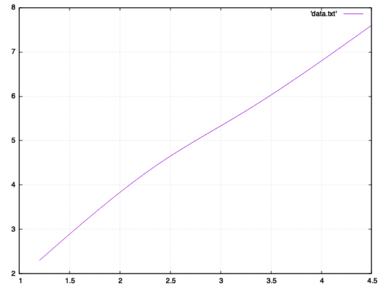

- `csplines` means cubic splines: small cubic curves joined so that the overall curve looks smooth.

- Other options are `bezier`, `sbezier`, `acsplines`, `unique` and `frequency`. Each uses a different smoothing method.

> Smoothing or interpolation only joins the points nicely. It cannot detect experimental noise and interpolates around all points, giving all equal value.

### 2.5 Least squares fitting

#### Theory

Assumption: The data follows some hidden formula with unknown constants (yet). Let, that formula be:

$$ y = a e^{-bx} $$

$a$ and $b$ are the unknown constants. LSF finds the values of $a$ and $b$ for which this curve is closest to my data.

> gnuplot uses the *Levenberg-Marquardt* algorithm for this.

Let, `data.txt` contain:

```
1.0 200.6
2.0 100.3
3.0 43.2
4.0 25.6
5.0 8.9
```

#### Process

The data drops quickly and flattens out, so we try a decaying exponential. This is guesswork. Process of fitting:

```bash
gnuplot> reset
gnuplot> f(x) = a*exp(-b*x)
gnuplot> a = 300 #a, b values needed for initial guess since process is iterative
gnuplot> b = 1
gnuplot> fit f(x) 'data.txt' u 1:2 via a,b # fit ... via to find a and b
gnuplot> plot 'data.txt' w p pt 1 ps 4, 'data.txt' smooth csplines, f(x) lw 3
gnuplot> print a, b
415.727591880944 0.725452619243909
```

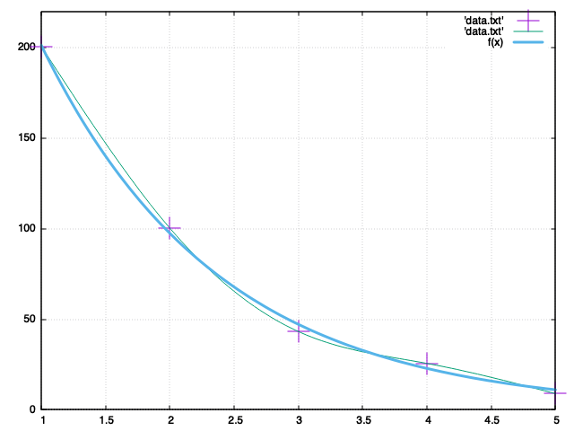

Hence, $y \approx 415.7\,e^{-0.7255\,x}$.

The spline passes exactly through every point, while the fitted curve goes near them and follows the overall trend.

## 3. Exercises - `plotlab1`

### 1(a)

In the case of $f(x)$, it is translated by plotting $sinx$ across the line $y = x$

```bash
set zeroaxis; set grid
set xrange [-2*pi:2*pi]; set yrange [:]
f(x) = x + sin(x)
g(x) = x
plot f(x) lw 2 title 'Translated Sine', g(x) lw 1 title 'Linear Component'
```

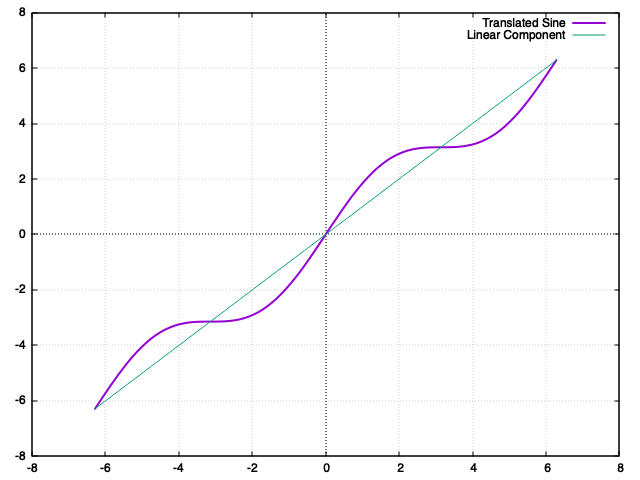

### 1(b)

Given, $f(x) = x^2 + x + 1 = (x + \frac{1}{2})^2 + \frac{3}{4}$ so the y-intercept is $(0, 1)$.

```bash
reset
set zeroaxis; set grid
set xrange [-3:3]; set yrange[:]

f(x) = x**2 + x + 1

$YIntercept << EOD
0 1
EOD

$Minimum << EOD
-0.5 0.75
EOD

set label 'Minimum Point' at -0.5, 1.5 center #so the point can be seen
plot f(x) lw 2 title 'Function', $YIntercept w p pt 7 ps 3 title 'Y-Intercept', $Minimum w p pt 5 ps 3 title 'Minima'
```

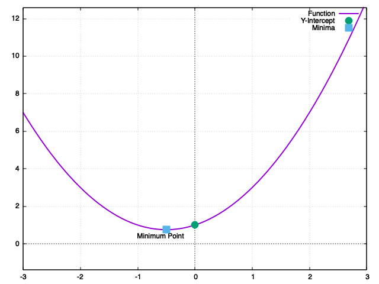

### 1(c)

The given function is $f(x) = x(x^2-1) = x(x-1)(x+1)$ so the three roots are $(-1,0)$, $(0,0)$, $(1,0)$.

```bash
reset
set zeroaxis; set grid
set xrange [-2:2]; set yrange[:]

f(x) = x*(x**2 - 1)

$Roots << EOD
-1  0
0   0
1   0
EOD

set arrow 1 from -1, 1 to -1, 0.15 head filled size screen 0.04, 30, 45 lw 2
set arrow 2 from 0, 1 to 0, 0.15 head filled size screen 0.04, 30, 45 lw 2
set arrow 3 from 1, 1 to 1, 0.15 head filled size screen 0.04, 30, 45 lw 2

#arrow syntax works: size <head_length>, <head_angle>, <back_angle>

set label 'Roots' at 0, 1 center

plot f(x) lw 2 title 'Function', $Roots w p pt 7 ps 3 title 'Roots'
```

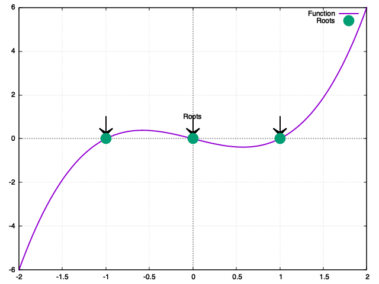

### 1(d)

The given equation is $f(x) = \frac{x^2}{x-1} = x + 1 + \frac{1}{x-1}$ so as $x$ tends towards $\pm\infty$, the fractional part tends to 0 so the oblique asymtote is along $y = x+1$.

```bash
reset
set zeroaxis; set grid
set xrange [-10:10]; set yrange[:]
set samples 400

f(x) = x**2/(x- 1)
g(x) = x  + 1

set arrow from 1, -10 to 1, 10 nohead lc 'black' dt 2

plot f(x) lw 2 title 'Function', g(x) lw 1.5 lc 'blue' dt 3 title 'Oblique Asymptote'
```

.png)

### 1(e)

```bash
reset
set zeroaxis; set grid
set xrange [0:10]; set yrange[:]


set key outside right top

f(x, a) = (a*x)**2 * exp(-a*x)

$Maxima << EOD
2.0000 0.5413
1.0000 0.5413
0.6667 0.5413
EOD

set arrow 1 from 2.0, 0.5413 to 2.0, 0 nohead lt 0 lw 1.5 lc 'black'
set arrow 2 from 1.0, 0.5413 to 1.0, 0 nohead lt 0 lw 1.5 lc 'black'
set arrow 3 from 0.6667, 0.5413 to 0.6667, 0 nohead lt 0 lw 1.5 lc 'black'

plot f(x, 1) lw 2 lc 'red' title "a=1", f(x, 2) lw 2 lc 'green' title "a=2", f(x, 3) lw 2 lc 'blue' title "a=3", $Maxima w p pt 7 ps 4 lc 'black' title "Maxima"
```

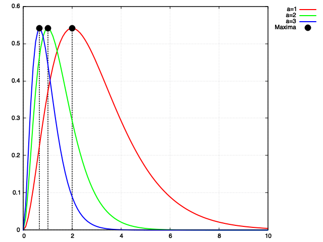

### 2(a)

```bash
reset
set zeroaxis; set grid
set xrange [-8:8]; set yrange[-5:5]

f(x) = x**3 + 1 - exp(x)

plot f(x) title 'Function' lw 2 lc 'blue', 'data.txt' u 1:2 title 'Intercepts' w p pt 7 ps 1.5 lc 'red', 'data.txt' u 1:2:3  title '' w labels offset -6, -2 textcolor 'red'
```

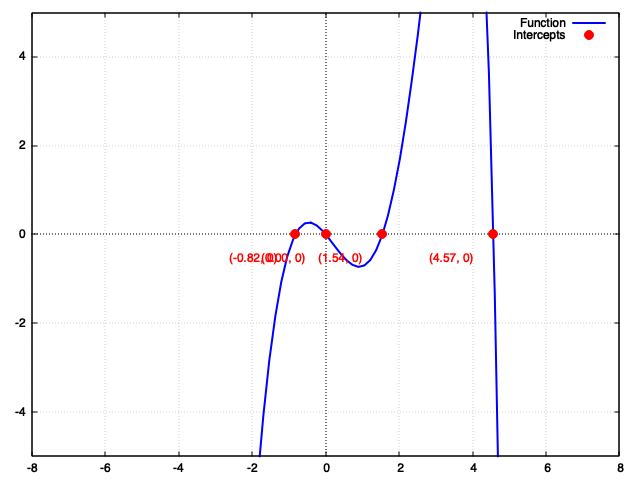

### 2(b) 

```bash
reset
set zeroaxis; set grid
set xrange [-2:2]; set yrange[-5:5]

f(x) = 3*x**4 - 6*x**2

$intercepts << EOD

-1.4142     0         "(-1.41, 0)"
0.0000      0         "(0.00, 0)"
1.4142      0         "(1.41, 0)"
EOD

plot f(x) title 'Function' lw 2 lc 'blue', $intercepts u 1:2 title 'Intercepts' w p pt 7 ps 1.5 lc 'red', $intercepts u 1:2:3 title '' w labels offset 0,0.8 tc 'red'
```

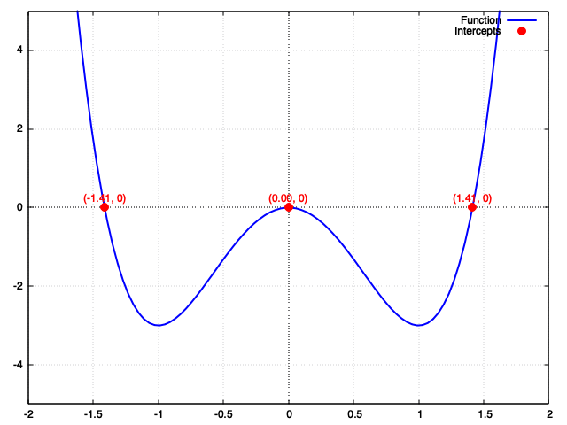

### 2(c)

```bash
reset
set zeroaxis; set grid
set xrange [-2:5]; set yrange[-2:10]

g(x) = 5*exp(-0.5*x)
h(x) = x + 1

$intersection << EOD
1.4372     2.4372     "(1.44, 2.44)"
EOD


set arrow from 0.5, 2.437 to 1.4372, 2.437 head filled lw 3 lc 'black' 

plot g(x) title 'g(x)' lw 2 lc 'blue', h(x) title 'h(x)' lw 2 lc 'green', $intersection u 1:2 title 'Intersection' w p pt 7 ps 1.5 lc 'red', $intersection u 1:2:3 title '' w labels offset 5.0, 0 tc 'red'
```
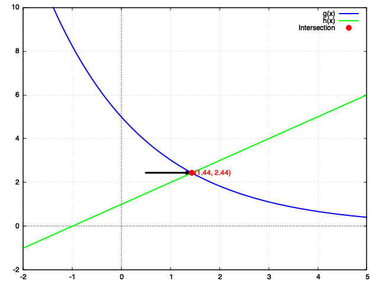

### 2(d)

```bash
reset
set zeroaxis; set grid
set xrange [-2:8]; set yrange[-2:12]

k(x) = x + 3*sin(2*x)
dk(x) = 1 + 6*cos(2*x)
f(x) = 4

$intersections << EOD
3.2678     4.0000     "(3.27, 4)"
4.8582     4.0000     "(4.86, 4)"
5.9338     4.0000     "(5.93, 4)"
EOD

plot k(x) title 'k(x)' lw 2.5 lc 'blue', f(x) title 'y = 4'  lw 1.5 lc 'black' dashtype 2, dk(x) title "k'(x)" lw 1.5 lc 'purple',  $intersections u 1:2 title "Intersections" w p pt 7 ps 1.5 lc "red", $intersections u 1:2:3 title "" w labels offset 0,0.8 tc "red"
```

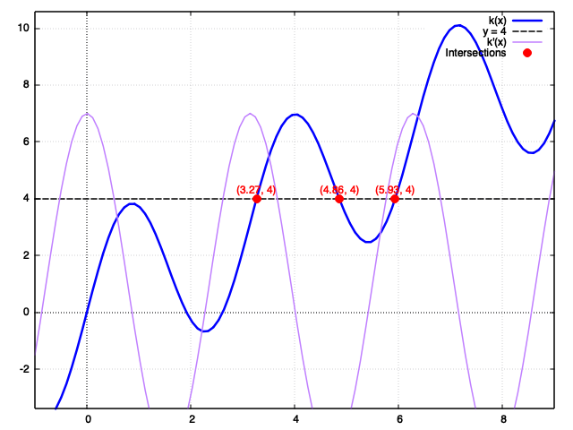

### 2(e)

```bash
reset
set zeroaxis; set grid
set xrange [0:100]; set yrange[-2:2]
set samples 1000

f(x) = exp(-x/100.0) * cos(x)
upper_env(x) = exp(-x/100.0)
lower_env(x) = -exp(-x/100.0)

$envelope << EOD
0.0000      1.0000     -1.0000
100.0000    0.3679     -0.3679
EOD


plot f(x) title "f(x)" lw 2 lc "blue", \
     upper_env(x) title "Envelope (+)" lw 1 lc "red" dashtype 2, \
     lower_env(x) title "Envelope (-)" lw 1 linecolor "red" dashtype 2
```

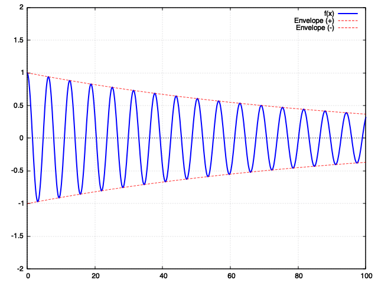

## 4. Exercises - `plotlab2`

### 1(a)

```bash
reset
set zeroaxis; set grid
set xrange [-0.5:]; set yrange[-1:]


plot 'simple1_dat.txt' title 'Points' w lp pt 7 ps 1.5 lw 2 lc 'blue'
```

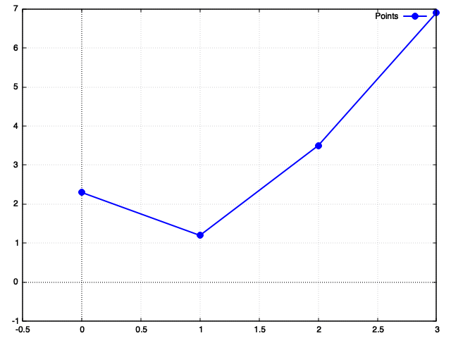

### 1(b)

```bash
reset
set zeroaxis; set grid
set xrange [-0.5:]; set yrange[-1:]


plot 'data.txt' title 'Segmented Join' w lp pt 7 ps 1.5 lw 2 lc 'blue', 'data.txt' title 'Smoothening' smooth bezier lw 2
```

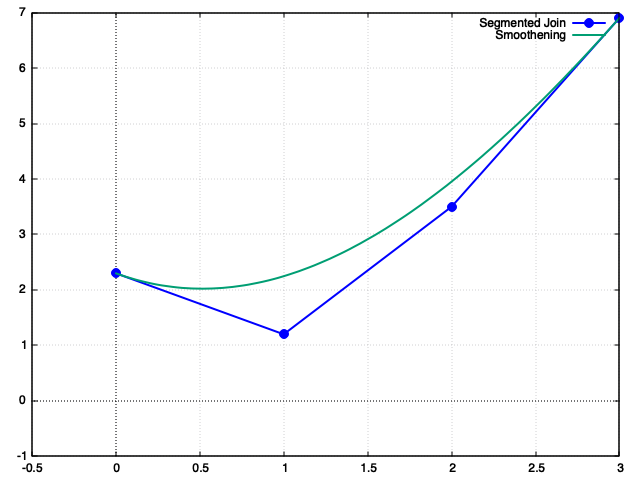

### 1(c)

**Important information extracted from the `.log` file:**

Optimized Equation:f(x) = 415.728 * exp(-0.725453 * x)

Parameter a: 415.728  (+/- 14.76)

Parameter b: 0.725453 (+/- 0.02464)

Iterations to Converge: 8

Average Error (RMS of Residuals): 3.49735

```bash
reset
set zeroaxis; set grid
set xrange [1:7]; set yrange[-50:]

f(x) = a*exp(-b*x)

a = 200
b = 1

fit f(x) 'data.txt' u 1:2 via a, b

plot 'data.txt' title 'Segmented Join' w lp pt 7 ps 1.5 lw 2, 'data.txt' title 'Smoothening' smooth csplines lw 2.5, 'data.txt' title 'Points' w p pt 7 ps 1.5, f(x) lw 2
```

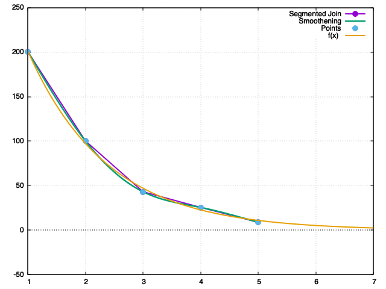

### 1(d)

```bash
reset
set zeroaxis; set grid
set xrange [:]; set yrange[:]


set samples 1000

set xlabel 'Time t(s)'; set ylabel 'Angle (mrad)'

f(x) = theta0 + a * exp(-x / tau) * sin(2 * pi * x / T + phi)

theta0 = 4.0
a = 40.0
tau = 60.0
T = 13.5
phi = -0.5

fit f(x) 'cavendish_dat.txt' u 1:2:3 via theta0, a, tau, T, phi

plot 'cavendish_dat.txt' index 0 u 1:2:3 title 'Ram (21st May)' w yerrorbars lw 2 pt 7 lc 'blue', \
     'cavendish_dat.txt' index 1 u 1:2:3 title 'Sam (22nd May)' w yerrorbars lw 2 pt 7 lc 'green', \
     f(x) title 'Best fit curve' lw 3 lc 'red'

```

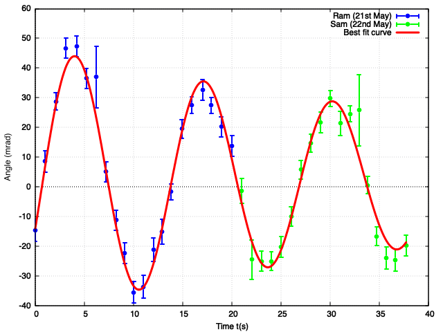

---

