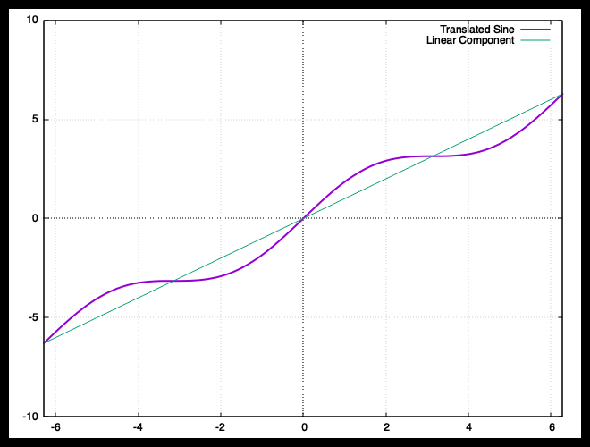

## Exercises from GNUPLOT 2-D Factsheet

### Exercise 1

#### 1(a)

Let, $f(x) = \sin(x) + x$. The factor $x$ modifies the regular sine curve hence, it looks like as if the curve was plotted using the $y = x$ line as an axis.

```bash
gnuplot> set zeroaxis
gnuplot> set grid
gnuplot> set xrange[-2*pi:2*pi]
gnuplot> f(x) = x + sin(x)
gnuplot> plot f(x) title 'Translated Sine' lw 2, x title 'Linear Component' lw 1
```


