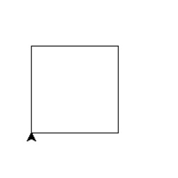
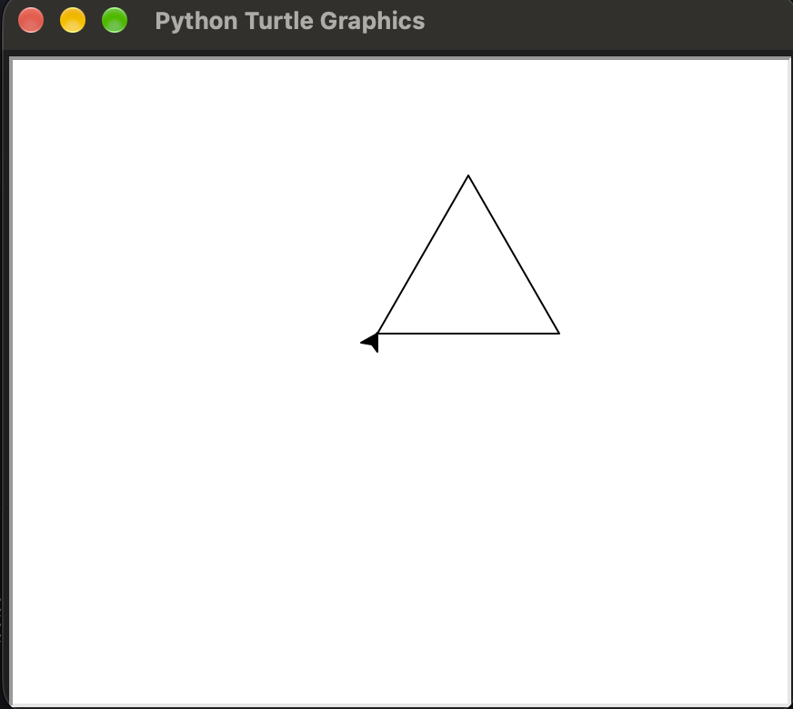
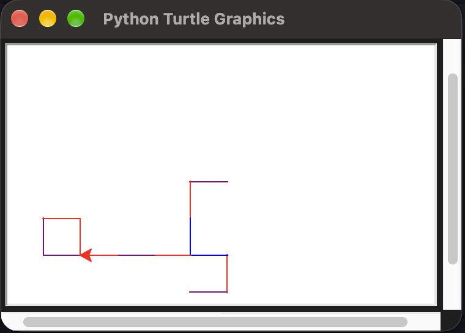

\vspace{2.5em}

\noindent\fbox{%
  \parbox{\dimexpr\linewidth-2\fboxsep-2\fboxrule}{%
    \textbf{Author:} Koushani Roy \\
    \textbf{Roll No:} 134 \\
    \textbf{Semester:} 1 \\
    \textbf{Paper Code:} C1PH230112P \\
    \textbf{Subject:} Clab - 1, UG (Physics) \\
    \textbf{Institution:} St. Xavier's College (Autonomous), Kolkata \\
    \textbf{Date:} October 26, 2026
  }%
}

\pagebreak

## Python: Work Done in Class

Each block is in the format: code block followed by output block.

### print and input

```python
print("Hello Snakes and Snakelets")
```

```
Hello Snakes and Snakelets
```

String repetition with `*`[a number]:

```python
print("Snakes"*5)
```

```
SnakesSnakesSnakesSnakesSnakes
```

`input()` reads a string into a variable. You must force type cast for anything else:

```python
s = input("Name? ")
print("Hello! " + s)
```

```
Name? Harun Al Rasid
Hello! Harun Al Rasid
```

### Data types

```python
a = '5'
a = 5
type(a)
b = '5'
type(b)
```

```
<class 'int'>
<class 'str'>
```

Single and double quotes both give `str`. Double quotes is prefered since single quotes is used for apostrophe and other that kind of things in english.

```python
b = 'string'
type(b)
b = "string"
type(b)
```

```
<class 'str'>
<class 'str'>
```

Use `\'` to use a single quote twice in the same line. 

```python
print('mr said \'abcd\'')
```

```
mr said 'abcd'
```

Alternatively you could use double quotes for the string.

```python
print("Mr. said 'abcd'")
```

```
Mr. said 'abcd'
```

Printing a variable `s` inside quotes: to print inside single quotes use `"'" + s + "'"`. Reverse for double quotes: `'"' + s + '"'`.

```python
print("'" + s + "'")
print('"' + s + '"')
```

`\n` is the new line character.

```python
print("Hello!\n" + s)
```

```
Hello!
Harun Al Rasid
```

`\t` is the tab character.

```python
print("Hello!\n\t" + s)
```

```
Hello!
        Harun Al Rasid
```

Used to print more than one line. Multiline Strings.

```python
poem = '''
Jack and Jill
went up to Hill
To fetch a pail of water
'''
print(poem)
```

```
Jack and Jill
went up to Hill
To fetch a pail of water
```

`i` is not used in Python. Complex numbers use `j` and for the complex number $i$ you cannot write `j` but must use `1j`.

```python
a = 1+1j
a
print(a)
```

```
(1+1j)
(1+1j)
```

`help()` shown with integer data type.

```python
help(int)
```

Points:

- `int(x, base=10)` converts a number or string to an integer
- Floating point numbers are truncated towards zero
- Valid bases are 0 and 2-36
- Base 0 means interpret the base from the string

```python
int('0b100', base=0)
```

```
4
```

### dir, help, del

`dir()` lists the names in the current session.

```python
dir()
```

```bash
['__annotations__', '__builtins__', '__cached__', '__doc__', '__file__', '__loader__', '__name__', '__package__', '__spec__']
```

```python
a = 10
dir()
```

```bash
['__annotations__', '__builtins__', '__cached__', '__doc__', '__file__', '__loader__', '__name__', '__package__', '__spec__', 'a']
```

`help(name)` shows help on things.

```python
help(a)
```
```
Help on int object:
```

`del` removes a name. You can use it with various things. Even in module directory.

```python
del(b)
dir()
```

### Import everything from math

```python
from math import *
dir()
```

### Importing specific names

```python
from math import atan2
help(atan2)
```

```
atan2(y, x, /)
    Return the arc tangent (measured in radians) of y/x.
    Unlike atan(y/x), the signs of both x and y are considered.
```

```python
from math import pi
atan2(-3,-3)*(180/pi)
```

```
-135.0
```

`^` is not power, so `e^planck` gives `NameError`. Import `exp` from math.

```python
planck = 6.6E-34
e^planck
```

```
NameError: name 'e' is not defined
```

```python
from math import exp
exp(planck)
```
```
1.0
```

`;` separates two statements on the same line. Can be used to write multiple things on same line, like in gnuplot.

```python
from math import sqrt
hcross= 1.055E-34; G=6.67E-11; c=3E8
print('hcross=' ,hcross, 'G= ',G, 'c= ', c)
```

```
hcross= 1.055e-34 G=  6.67e-11 c=  300000000.0
```

```python
lpl= sqrt((hcross * G)/(c**3))
lpl
print(lpl)
print('Plank Length= ', lpl)
print('Plank Length= ', lpl , 'm')
```
```
1.6143855613640568e-35
1.6143855613640568e-35
Plank Length=  1.6143855613640568e-35
Plank Length=  1.6143855613640568e-35 m
```

### for loop

```python
for i in range(7):
    print(i)
```

```
0
1
2
3
4
5
6
```
The range always includes the lower bound and never the upper bound. The lower bound usually is 0 unless specified.

### while loop

After `nstep += 1`, press two enters.

```python
MaxSteps = 4
nstep = 0
while nstep < MaxSteps:
    print(nstep)
    color('red')
    fd(100);rt(90)
    nstep += 1
```

```
0
1
2
3
```

Triple dot `...` is the continuation prompt. There are instructions inside a module help according to function definition based on which you can continue the prompt (example, `h`)

### Defining cls inside a function

```python
import os
def cls():
    '''
    cls: clear the screen, aka dos
    '''
    os.system('cls')
```

`help(cls)` shows the docstring:

```
Help on function cls in module __main__:

cls()
    cls: clear the screen, aka dos
```

### Using system directly

```python
from os import system
system('cls')
```

### Writing a module from notepad

```
notepad mythings.py
```

Contents of `mythings.py`:

```python
import os
def cls():
    os.system('cls')
```

Import it from python:

```
python
```

```python
from mythings import cls
```

### Turtle

`python -m <modulename>` can be used to run the module as a script.

```python
from turtle import *
```

`mode('logo')` - in logo mode, the turtle starts facing North (Up) and positive angles turn clockwise, whereas in standard mode, it starts facing East (Right) and turns counterclockwise.

The following ways all draw a square:

```python
mode('logo')
reset()
fd(100);rt(90);fd(100);rt(90);fd(100);rt(90);fd(100);rt(90)
```

Using a for loop:

```python
for step in range(4):
    print(step)
    fd(100);rt(90)
```

```
0
1
2
3
```



`reset()` deleted the square, we can start from the beginning. Using `sleep` would halt between the steps of drawing the sides of the square.

```python
from time import sleep
reset()
```

### Making your own module (tmod)

Contents of `tmod.py`:

```python
'''
Draw a box using turtle
'''

from turtle import *
mode('logo')
#reset

def drwsqr(l,c):
    color(c)
    for step in range(4):
        fd(l);rt(90)
```

Go to terminal, start python and import tmod:

```python
import tmod
dir()
dir(tmod)
help(tmod)
```

```
Help on module tmod:

NAME
    tmod - Draw a box using turtle

FUNCTIONS
    drwsqr(l, c)

FILE
    #filePathName
```

Call the function with the module name:

```python
tmod.drwsqr(100,'red')
```

## Exercise 1

```bash
roykoush@Koushanis-MacBook-Air Exercises % python3
Python 3.14.8 (main, Sep 30 2026, 17:55:09) [Clang 21.0.0 (clang-2100.3.34.2)] on darwin
Type "help", "copyright", "credits" or "license" for more information.
>>> a = 1+2j
>>> b = 3+4j
>>> print(a,b)
(1+2j) (3+4j)
>>> r = a/b
>>> p = a*b.conjugate()
>>> print(r,p)
(0.44+0.08j) (11+2j)

```

## Exercise 2

```python
n = int(input('n: '))

#Left justified
for i in range(n+1):
    print(('*'*i).ljust(n))

#Right justified
for i in range(n+1):
    print(('*'*i).rjust(n))

#Centre justified
for i in range(n+1):
    print(('*'*(2*i-1)).center(2*n-1))
```

```bash
#Output
(.venv) roykoush@Koushanis-MacBook-Air Exercises % python3 expy.py 
n: 5
     
*    
**   
***  
**** 
*****
     
    *
   **
  ***
 ****
*****
         
    *    
   ***   
  *****  
 ******* 
*********
```

## Exercise 3

```python
n = 26
for i in range(27, 52):
    print(i%26, end=',')

```

```bash
#Output
(.venv) roykoush@Koushanis-MacBook-Air Exercises % python3 expy.py
1,2,3,4,5,6,7,8,9,10,11,12,13,14,15,16,17,18,19,20,21,22,23,24,25,% 
```

## Exercise 4

```python
>>> import phyconsts
>>> help(phyconsts)

>>> print(dir(phyconsts))
['G', 'M_earth', 'M_sun', 'NA', 'R', 'R_earth', '__builtins__', '__cached__', '__doc__', '__file__', '__loader__', '__name__', '__package__', '__spec__', 'c', 'e', 'epsilon0', 'g', 'giga', 'h', 'hbar', 'kB', 'kilo', 'me', 'mega', 'micro', 'milli', 'mp', 'mu0', 'sigma']
>>>
```

## Exercise 5

```python
from turtle import *
mode('logo')
rt(30)
for i in range(3):    
    fd(50); rt(120)

done()
```



## Exercise 6

```python
import random
from turtle import *
L = [0, 90, 180, 270]
L2 = ['red', 'blue', 'green', 'purple']
reset()
mode('logo')
for i in range(20):    
    color(random.choice(L2))    
    rt(random.choice(L))    
    fd(30)

done()
```



---
